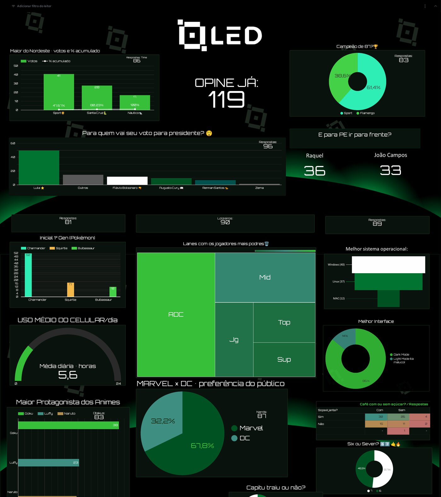

# Looker + Google Forms em tempo real

Dashboard ao vivo no **Data Studio** (antigo Looker Studio) alimentado pelas respostas de um **Google Forms**, sem esperar o cache de 15 minutos do conector padrão do Google Sheets.

A peça central é um **Community Connector** escrito em Apps Script: ele lê a planilha de respostas do Forms diretamente a cada consulta, então basta clicar em **Atualizar** no painel para ver as respostas que acabaram de chegar.

Material do encontro semanal da [LED](https://github.com/LED-CIn-UFPE) sobre dashboards alimentados em tempo quase real, usado no painel do **Open Day** da liga.



## Como funciona

```
Google Forms  ──►  Planilha de respostas  ──►  Conector Apps Script  ──►  Data Studio
                    (Google Sheets)             (getSchema / getData)      (Atualizar = dado novo)
```

- `getConfig` pede a URL da planilha e, opcionalmente, o nome da aba.
- `getSchema` lê o cabeçalho da planilha: cada pergunta do Forms vira uma **dimensão** de texto, e o conector adiciona a métrica **Respostas**, que vale 1 por linha e é somada.
- `getData` lê as linhas da planilha no momento da consulta e devolve só os campos que o gráfico pediu.

Com isso, qualquer gráfico do tipo "pergunta × Respostas" mostra a contagem de votos por alternativa.

## Arquivos

| Arquivo | Conteúdo |
|---|---|
| `connector/Code.gs` | Código do conector |
| `connector/appsscript.json` | Manifesto com o bloco `dataStudio`, que identifica o projeto como conector |

## Passo a passo

### 1. Formulário e planilha

1. Crie o formulário no Google Forms.
2. Na aba **Respostas**, clique em **Vincular ao Planilhas** para gerar a planilha de respostas.

### 2. Projeto no Apps Script

1. Acesse [script.google.com](https://script.google.com) e crie um **Novo projeto**.
2. Em **Configurações do projeto**, marque **Mostrar arquivo de manifesto "appsscript.json" no editor**.
3. Substitua o conteúdo de `appsscript.json` e de `Código.gs` pelos arquivos da pasta `connector/`.
4. Se quiser, ajuste `name`, `company` e as URLs do bloco `dataStudio`, que aparecem na tela de seleção do conector.

### 3. Projeto no Google Cloud

O Apps Script precisa de um projeto do Google Cloud padrão (não o automático) com a tela de consentimento OAuth configurada.

1. No [Google Cloud Console](https://console.cloud.google.com), crie um projeto. O nome precisa ter entre 4 e 30 caracteres.
2. Em **Google Auth Platform**, configure a tela de consentimento OAuth: nome do app, e-mail de suporte e público-alvo.
3. Copie o **Número do projeto** no painel do projeto.
4. De volta ao Apps Script, em **Configurações do projeto → Projeto do Google Cloud Platform (GCP)**, clique em **Alterar projeto** e cole o número.

### 4. Implantação

1. No Apps Script, clique em **Implantar → Nova implantação** e copie o **ID da implantação**.
   Para testar enquanto edita o código, use **Implantar → Testar implantações**: o ID de teste sempre aponta para a versão mais recente do código.
3. Abra no navegador:

   ```
   https://datastudio.google.com/datasources/create?connectorId=ID_DA_IMPLANTACAO
   ```

### 5. Fonte de dados e relatório

1. Na tela do conector, clique em **Autorizar** e conceda o acesso à planilha.
2. Cole a **URL da planilha de respostas** e, se necessário, o **nome da aba**, por exemplo `Respostas ao formulário 1`.
3. Clique em **Conectar**. As perguntas aparecem como dimensões e **Respostas** como métrica.
4. Clique em **Criar relatório** e monte os gráficos: barras, pizza, treemap, scorecard ou tabela, sempre com uma pergunta como dimensão e **Respostas** como métrica.
5. Durante o evento, clique em **Atualizar** no painel para buscar as respostas novas.

## Cuidados

- Quem abre o relatório vê as respostas da planilha. Compartilhe o painel só com quem deve vê-las, e confira nas configurações da fonte de dados se as credenciais usadas são as do proprietário ou as do leitor.
- Como não há cache, cada atualização relê a planilha inteira. Para formulários com milhares de respostas, considere agregar os dados numa aba separada.
- O Data Studio mostra o aviso de que o conector não foi verificado pelo Google. Isso é esperado para conectores da comunidade de uso interno.
